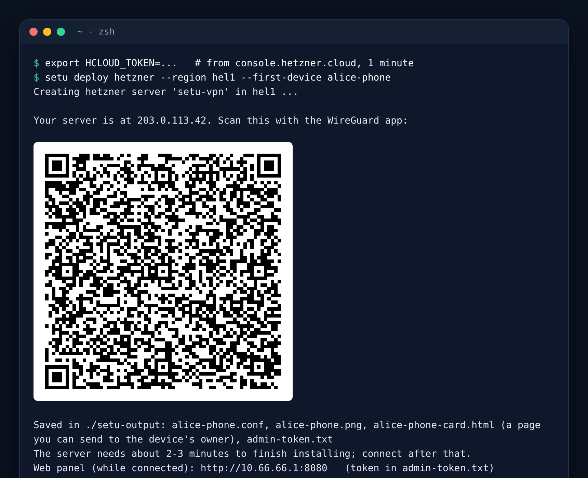
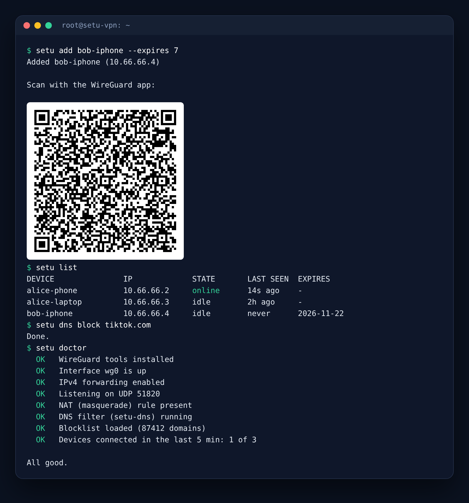
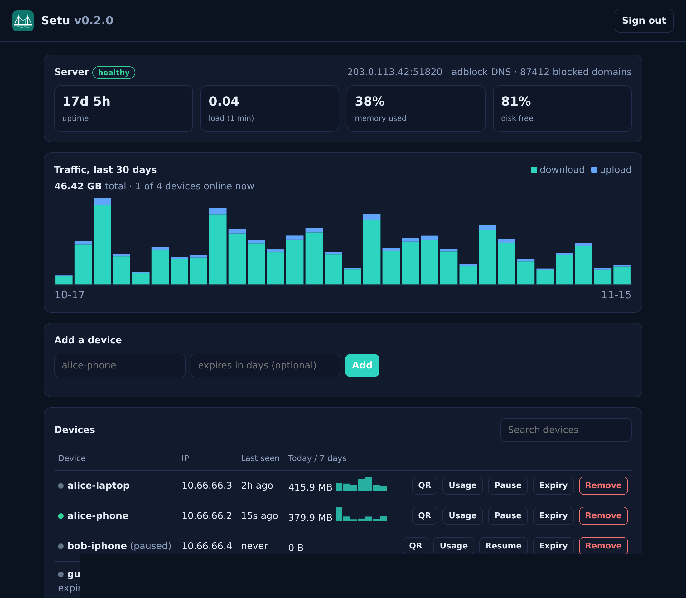
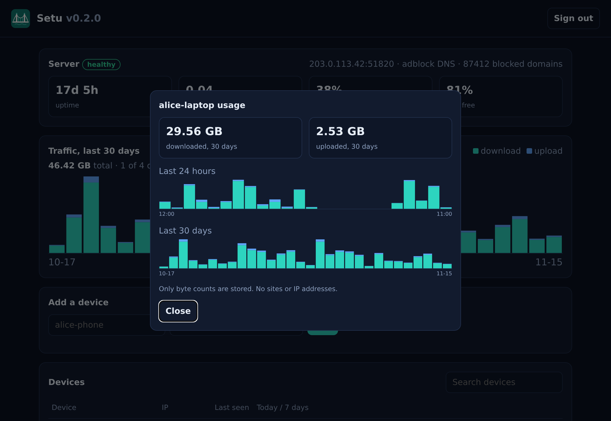
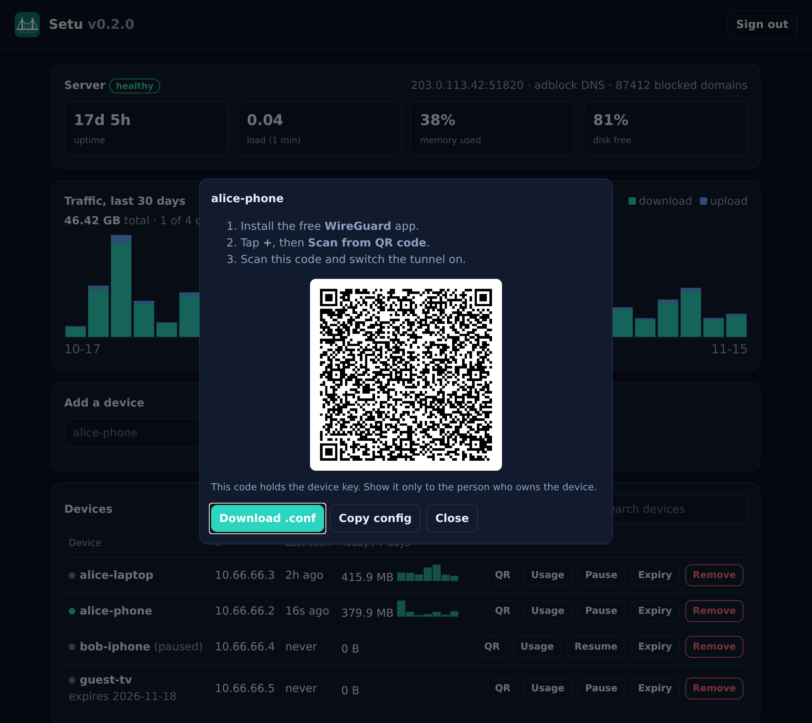
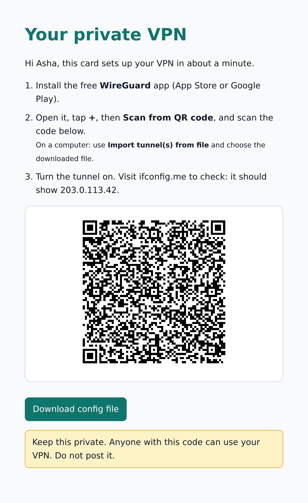
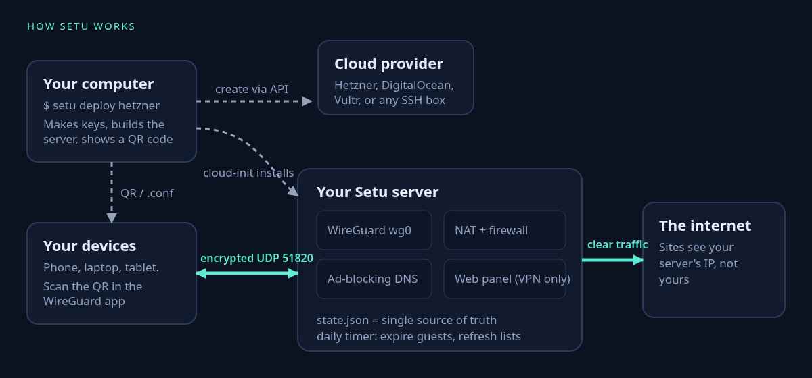

<p align="center">
  
</p>

<p align="center">
  
  <a href="LICENSE"></a>
  
  
  
  
</p>

**Setu** (Hindi/Bengali for *bridge*) sets up your own private VPN server in about three minutes. You run one command, scan a QR code with the WireGuard app, and you are connected through a server that only you control.

It is built for people who want the privacy of a self-hosted VPN without learning Ansible, firewalls or WireGuard config files.

- **One command.** `setu deploy hetzner` creates the server, installs everything and shows a QR code.
- **Zero dependencies.** Pure Python standard library. It even makes WireGuard keys and QR codes itself, so nothing needs installing on your laptop.
- **Ad and tracker blocking** built in (DNS level, with a community blocklist of tens of thousands of domains and your own allow and block rules).
- **Web panel** with server health, 30-day traffic charts per device, QR codes, pause, expiry and search. It listens on the VPN address only, so it is never exposed to the internet.
- **Send a friend a setup card.** `setu card asha-phone --lang hi` writes one page with a QR code and three steps in English, Hindi or Bengali.
- **Guest devices that expire.** `setu add guest-tv --expires 3` removes itself after three days.
- **Safe defaults.** Fresh keys per device plus a pre-shared key, devices cannot talk to each other, IPv6 does not leak, only SSH and the WireGuard port are open.
- **Health checks and usage history.** `setu doctor` and `setu health` say what is wrong and how to fix it. `setu usage` shows data per device. Only byte counts are stored, never sites or IPs.
- **Clean uninstall.** `setu uninstall` removes everything it installed.

<p align="center">
  
</p>

## Quick start

You need a computer with Python 3.10+ and the [WireGuard app](https://www.wireguard.com/install/) on your phone or laptop. Pick **one** of the three ways to get a server.

### Option A: let Setu create a cloud server (easiest)

1. Make an API token with your provider (Hetzner: *Security > API tokens*, read and write).
2. Run:

```sh
git clone https://github.com/AnuragRoy485/setu && cd setu
export HCLOUD_TOKEN=your-token-here
python3 -m setu deploy hetzner --first-device my-phone
```

3. Scan the QR code with the WireGuard app, wait 2-3 minutes for the server to finish installing, and switch the tunnel on.

| Provider | Command | Token variable | Default region | Default size |
|---|---|---|---|---|
| Hetzner Cloud | `setu deploy hetzner` | `HCLOUD_TOKEN` | `hel1` | cheapest x86 type (picked from the live price list) |
| DigitalOcean | `setu deploy digitalocean` | `DIGITALOCEAN_TOKEN` | `blr1` (Bangalore) | `s-1vcpu-512mb-10gb` |
| Vultr | `setu deploy vultr` | `VULTR_API_KEY` | `blr` (Bangalore) | `vc2-1c-1gb` |
| Scaleway (new, not yet run live) | `setu deploy scaleway` | `SCW_SECRET_KEY` + `SCW_DEFAULT_PROJECT_ID` | `fr-par-1` | `DEV1-S` |
| Linode (Akamai) | `setu deploy linode` | `LINODE_TOKEN` | `us-east` | `g6-nanode-1` |

Use `--region` and `--size` to change them. You pay the provider directly, usually a few dollars a month. Setu is free. Delete the server any time with `setu destroy <provider> <id>` (the id is printed after deploy).

### Option B: a server you already have (Oracle Cloud free tier, AWS, GCP, a home server ...)

Any Ubuntu, Debian or Fedora machine with a public IP and SSH access works:

```sh
python3 -m setu deploy ssh --host root@203.0.113.10
```

Or log in to the server and run the installer there:

```sh
curl -fsSL https://raw.githubusercontent.com/AnuragRoy485/setu/main/install.sh | sudo sh
```

Remember to allow **UDP 51820** in your cloud firewall or security group (Oracle, AWS and GCP block it by default).

### Option C: install the `setu` command

```sh
pipx install git+https://github.com/AnuragRoy485/setu     # or: pip install --user git+https://github.com/AnuragRoy485/setu
setu deploy digitalocean --first-device laptop
```

## Everyday use

Once the server is up, manage it from the server itself, from your laptop over SSH (`-H root@server`), or from the web panel.

```sh
setu add alice-laptop              # new device, shows a QR code
setu add guest-tv --expires 3      # removes itself after 3 days
setu add office --split 10.0.0.0/8 # split tunnel: only these networks use the VPN
setu list                          # who is online, last seen, expiry
setu pause alice-laptop            # switch a device off without deleting it
setu remove alice-laptop           # its config stops working at once
setu qr alice-laptop               # show the QR code again
setu dns block tiktok.com          # block a domain for everyone
setu dns allow example-shop.com    # never block a domain
setu usage                         # data downloaded and uploaded per device
setu expire guest-tv 7             # change when a device expires
setu card asha-phone --lang hi     # one-page setup card to send to a friend
setu doctor                        # health check with fix hints
setu health --json                 # same, plus uptime, load, disk; exit 1 on trouble
setu -H root@203.0.113.10 list     # run any command on the server from your laptop
```

<p align="center">
  
</p>

### The web panel

Connect to your VPN, then open `http://10.66.66.1:8080` and sign in with the admin token that was printed at install (`setu token` makes a new one). The panel only listens on the VPN address, so someone on the internet cannot even reach it.

<p align="center">
  <br>
  <br>
  <br>
  <sub>The screenshots come from the real panel running on demo data.</sub>
</p>

### Send a setup card to a friend

Not everyone wants to read docs. `setu card NAME` writes a single HTML page with the QR code and plain steps, in English (`--lang en`), Hindi (`hi`) or Bengali (`bn`). Send it in a private chat. It contains the device key, so delete it afterwards.

<p align="center">
  
</p>

## How it works

<p align="center">
  
</p>

1. `setu deploy` creates the server keys and your first device on **your** computer (WireGuard keys are Curve25519, implemented in pure Python and checked against the RFC 7748 test vectors).
2. It asks the cloud provider for a small Ubuntu server and passes an install script (cloud-init). The script downloads Setu, installs `wireguard`, `iptables` and `dnsmasq`, turns on forwarding, writes the config and starts the services. It deletes its own copy of the keys afterwards.
3. `/etc/setu/state.json` is the single source of truth. Every command edits it, regenerates `/etc/wireguard/wg0.conf`, the firewall script and the DNS config, and applies peers live with `wg syncconf`, so connected devices never drop.
4. A daily systemd timer removes expired guests and refreshes the blocklist. A 5-minute timer records per-device byte counters for the usage charts.

What gets installed on the server: `wg-quick@wg0`, `setu-dns.service` (dnsmasq, only on the VPN address), `setu-web.service` (the panel), `setu-maintenance.timer`, `setu-sample.timer`, and the `setu` command in `/usr/local/bin`.

## Supported servers

Debian, Ubuntu, Fedora and the Red Hat family, and Arch (and Manjaro, EndeavourOS). Alpine is not supported yet because it uses OpenRC instead of systemd. IPv6 works when the server has it. If it does not, devices use IPv4 only and nothing leaks, and `setu doctor` tells you which case you are in.

## Security notes

- **Per device keys + pre-shared key.** Each device has its own key pair and a pre-shared key for an extra layer against future attacks on the key exchange.
- **Devices are isolated** from each other by default. Use `--allow-device-traffic` at install if you want a shared LAN feel.
- **No IPv6 leak.** Clients route `::/0` into the tunnel, so IPv6 traffic never bypasses it, even on servers without IPv6.
- **Host firewall.** Cloud deploys turn on `ufw` (SSH and the WireGuard port only) and automatic security updates. If you gave `--ssh-key`, password SSH login is switched off.
- **Panel safety.** Listens on the VPN address only, bearer token (stored as a SHA-256 hash), slows down wrong guesses, strict content security policy.
- **Where keys live.** Device private keys are kept in `state.json` (root only, mode 600) so you can show a QR code again. If you would rather the server never see a device key, run `setu add NAME --public-key <key from your device>`.
- **Cloud-init keeps your server key briefly.** For cloud deploys the server key travels in the provider's user-data. Setu deletes the on-disk copy after install, but the provider's account can still read it, so protect your provider account with 2FA.
- Setu does not log traffic and the DNS filter keeps no query log.

Found a problem? See [SECURITY.md](SECURITY.md).

## Setu and Algo VPN

[Algo](https://github.com/trailofbits/algo) is a great, mature project and the inspiration for this one. Setu is a fresh, from-scratch implementation (it contains no Algo code) with a different goal: fewer moving parts.

| | Setu | Algo |
|---|---|---|
| Needs on your computer | Python 3.10+ (stdlib only) | Python, Ansible and several packages |
| Setup | One command, QR on screen | Config file, then playbook |
| Protocols | WireGuard | WireGuard and IPsec |
| Providers | Hetzner, DigitalOcean, Vultr, Linode, any SSH server | Many more clouds |
| Add or remove users later | `setu add` / web panel, no re-deploy | Edit config and re-run |
| Ad blocking | Built in, editable rules | Built in |
| Web panel | Yes (VPN-only) | No |
| Guest devices that expire | Yes | No |

If you need IPsec or a provider Setu does not support yet, use Algo. Adding a provider to Setu is about 40 lines, see [docs/providers.md](docs/providers.md).

## Documentation

- [Provider guide and adding a provider](docs/providers.md)
- [Connecting your devices (iPhone, Android, macOS, Windows, Linux)](docs/clients.md)
- [Command reference and options](docs/commands.md)
- [Troubleshooting](docs/troubleshooting.md)
- [Changelog](CHANGELOG.md) · [Contributing](CONTRIBUTING.md) · [Security](SECURITY.md)

## Uninstall

```sh
sudo setu uninstall            # stops and removes services; keeps devices so a reinstall restores them
sudo setu uninstall --purge    # also deletes /etc/setu, keys and devices
setu destroy hetzner 12345     # delete the whole cloud server (stops billing)
```

## What is tested

The test suite (`python3 -m pytest`, 40+ tests,  covers: X25519 against RFC 7748 vectors and the `cryptography` library, the QR encoder decoded back with OpenCV, config rendering, address allocation, expiry, the firewall script run against real `iptables` in a throwaway network namespace (idempotent up, clean down), the full install procedure in a sandbox directory, the web API end to end, cloud provider requests against recorded fake APIs, and the generated cloud-init script.

What is **not** covered by automated tests: a real WireGuard tunnel carrying real traffic and live cloud API calls (they need a real server and a paid account). Those paths follow the providers' public API documentation. If something differs on your provider, please open an issue with the output of `setu doctor`.

## Contributing

Issues and pull requests are welcome, especially new providers, translations of the docs and client guides. Start with [CONTRIBUTING.md](CONTRIBUTING.md) and look for the `good first issue` label.

## License

MIT. Built with love in Calcutta by [Anurag Roy](https://github.com/AnuragRoy485).
